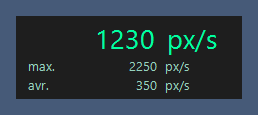

# MouseSpeedometer

マウスポインターの移動速度（px/s）をリアルタイムにデスクトップへ表示する、Windows 用の小さなガジェットです。

*A tiny always-on-top Windows desktop gadget that shows your mouse pointer speed (px/s) in real time, with max / average stats.*



## 特長

- 現在の速度・最高速度（max.）・平均速度（avr.）を3行で表示（数字は右揃え）
- 更新間隔ごとの区間平均を 10px/s 単位で表示するので、数字が読み取りやすい
- 常に最前面・タスクバーに出ない・半透明
- 右クリックメニュー
  - **この位置で固定**（チェックのトグル。外すと左ドラッグで移動可能）
  - **max. / avr. をリセット**
  - **設定...**（フォント種類・フォントサイズ・更新間隔）
  - **About** / **終了**
- 設定と表示位置は自動保存（`%APPDATA%\MouseSpeedometer\settings.json`）
- 二重起動防止・高DPI対応
- 追加ランタイム不要（Windows 標準の .NET Framework 4.x で動作）

## 使い方

### A. exe 版（おすすめ）

ソースからビルドします。Windows 標準の `csc.exe` を使うので、Visual Studio などのインストールは不要です。

```powershell
git clone https://github.com/kajiyajp/MouseSpeedometer.git
cd MouseSpeedometer
powershell -ExecutionPolicy Bypass -File .\build.ps1
```

`MouseSpeedometer.exe` ができるので、ダブルクリックで起動します。

### B. PowerShell スクリプト版

ビルドせずにそのまま動かす場合は `start.bat` をダブルクリックします（中身は `MouseSpeedometer.ps1`）。

## 表示の意味

| 行 | 内容 |
|---|---|
| 1行目 | 現在の速度。更新間隔（既定 0.5 秒）ごとの区間平均 |
| max. | 起動（またはリセット）してからの最高速度 |
| avr. | マウスを動かしていた時間だけで計算した平均速度（止まっていた時間は除外） |

- 単位は px/s（1秒あたりに動いたピクセル数）
- exe 版は高DPI対応のため物理ピクセル、ps1 版は環境によっては論理ピクセルで計測されます

## コード署名について

`build.ps1` は初回実行時に、自己署名のコード署名証明書を `Cert:\CurrentUser\My` に作成し、exe に署名します。

- 自己署名のため、署名状態は「未信頼（UnknownError）」になりますが、起動には影響しません
- 自分の PC で信頼済みにしたい場合は、出力される `MouseSpeedometer.cer` を以下で登録します（Windows のセキュリティ警告が出ます）

```powershell
Import-Certificate -FilePath .\MouseSpeedometer.cer -CertStoreLocation Cert:\CurrentUser\Root
Import-Certificate -FilePath .\MouseSpeedometer.cer -CertStoreLocation Cert:\CurrentUser\TrustedPublisher
```

- 証明書は各自の PC で生成されます。秘密鍵はリポジトリに含まれません

## ファイル構成

| ファイル | 役割 |
|---|---|
| `MouseSpeedometer.cs` | exe 版のソース（C# 5 / WinForms） |
| `build.ps1` | アイコン生成 → コンパイル → 自己署名 |
| `MouseSpeedometer.ps1` | PowerShell スクリプト版 |
| `start.bat` | ps1 版の起動用 |
| `MouseSpeedometer.ico` | アイコン（`build.ps1` が無ければ生成） |

## 動作環境

- Windows 10 / 11
- .NET Framework 4.x（Windows に標準搭載）

## ライセンス

[MIT License](LICENSE)
